# Yami Material Night


Midnight Discord theme in [yami](https://github.com/Trendorin/yami) palette colors — dark, minimal, generated from your wallpaper.

## Preview

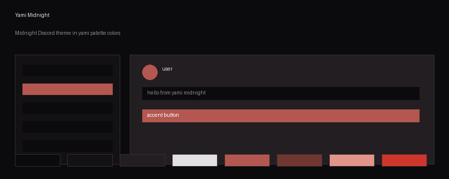

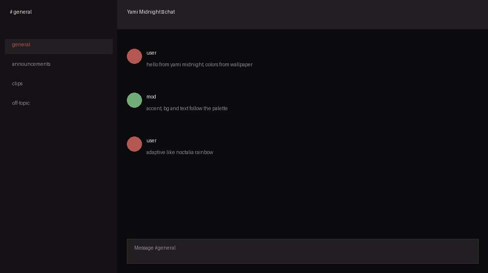

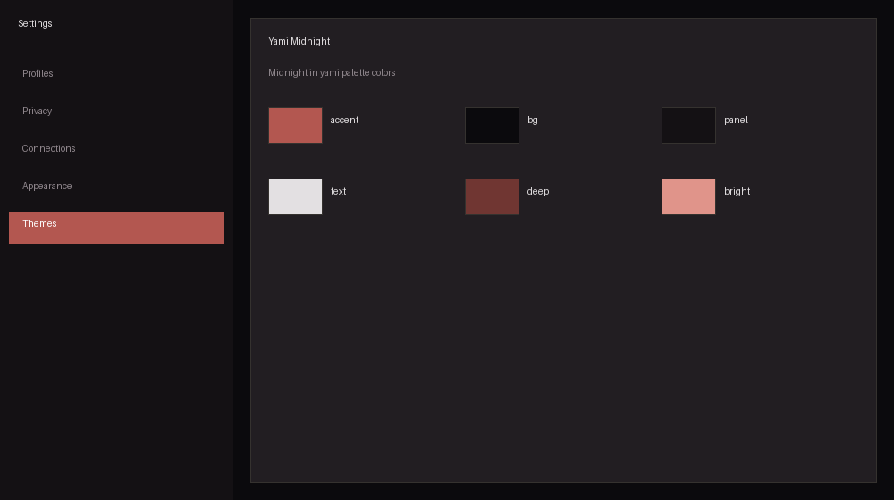

## Variants

Static snapshots — pick your palette, install by URL:

### Yami Material Night
Install: https://raw.githubusercontent.com/Minish777/yami-material-night/master/themes/flavors/yami-material-night.theme.css
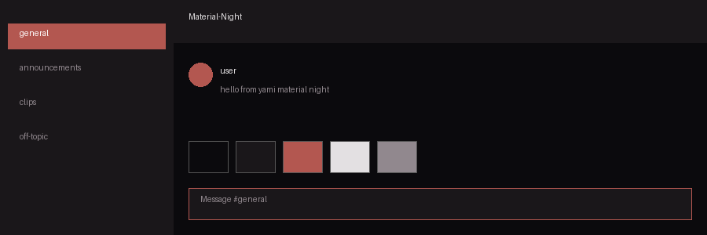

### Yami Material Night Gruvbox
Install: https://raw.githubusercontent.com/Minish777/yami-material-night/master/themes/flavors/yami-gruvbox.theme.css
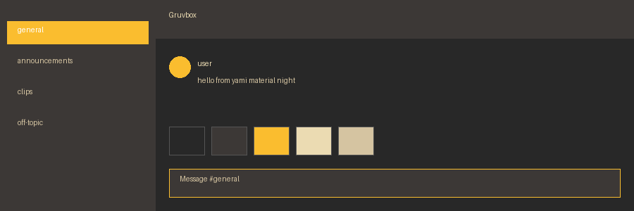

### Yami Material Night Gruvbox Dark
Install: https://raw.githubusercontent.com/Minish777/yami-material-night/master/themes/flavors/yami-gruvboxdark.theme.css
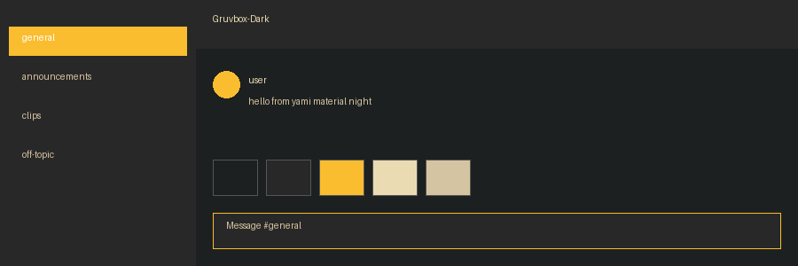

### Yami Material Night Nord
Install: https://raw.githubusercontent.com/Minish777/yami-material-night/master/themes/flavors/yami-nord.theme.css
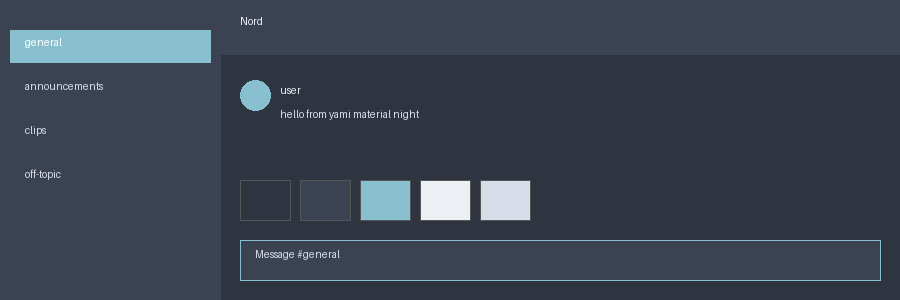

### Yami Material Night Rose Pine
Install: https://raw.githubusercontent.com/Minish777/yami-material-night/master/themes/flavors/yami-rosepine.theme.css
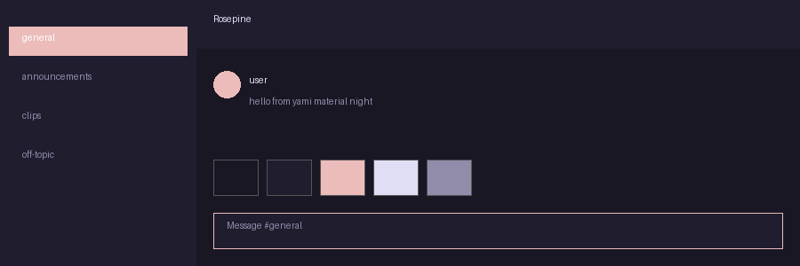

### Yami Material Night Dracula
Install: https://raw.githubusercontent.com/Minish777/yami-material-night/master/themes/flavors/yami-dracula.theme.css
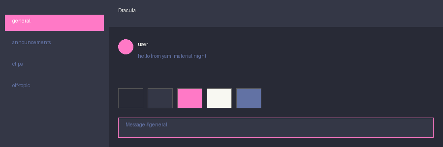

### Yami Material Night OneDark
Install: https://raw.githubusercontent.com/Minish777/yami-material-night/master/themes/flavors/yami-onedark.theme.css
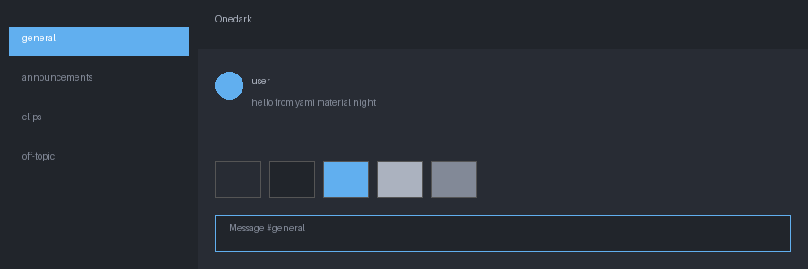

### Yami Material Night Tokyo Night
Install: https://raw.githubusercontent.com/Minish777/yami-material-night/master/themes/flavors/yami-tokyonight.theme.css
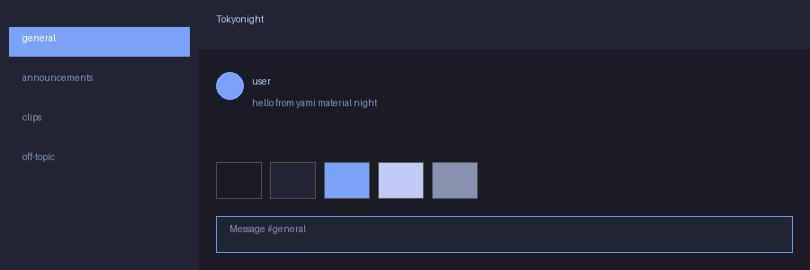

### Yami Material Night Catppuccin Latte
Install: https://raw.githubusercontent.com/Minish777/yami-material-night/master/themes/flavors/yami-catppuccin-latte.theme.css

### Yami Material Night Catppuccin Frappe
Install: https://raw.githubusercontent.com/Minish777/yami-material-night/master/themes/flavors/yami-catppuccin-frappe.theme.css

### Yami Material Night Catppuccin Macchiato
Install: https://raw.githubusercontent.com/Minish777/yami-material-night/master/themes/flavors/yami-catppuccin-macchiato.theme.css

### Yami Material Night Catppuccin Mocha
Install: https://raw.githubusercontent.com/Minish777/yami-material-night/master/themes/flavors/yami-catppuccin-mocha.theme.css

## Install

In BetterDiscord / Equicord / Vencord / Equibop add the theme by URL:

```
https://raw.githubusercontent.com/Minish777/yami-material-night/master/themes/flavors/yami-material-night.theme.css
```

Theme: `themes/flavors/yami-material-night.theme.css`. DM icon is the yami logo (`assets/yami-logo.svg`).
Layout modules come from the original Midnight build.

## Dynamic version (changes with your wallpaper)

A Discord theme file is static CSS — it cannot recolor itself when the wallpaper changes.
The dynamic version lives locally and is generated from yami's wallpaper palette:

1. Install yami and enable the wallpaper palette:
   ```sh
   yami palette wallpaper
   ```
   The accent and the whole palette now follow your wallpaper automatically.

2. Add the client template at `~/.config/yami/templates/equibop` (Midnight structure
   with palette placeholders + output line):

   ```css
   /* yami-output: ~/.config/equibop/themes/yami.theme.css */
   @import url('https://refact0r.github.io/midnight-discord/build/midnight.css');
   /* ... Midnight options ... */
   :root {
     --colors: on;
     --bg-4: {{bg}};
     --text-1: {{text}};
     --accent-1: {{accent}};
     --accent-2: {{deep}};
     /* ... */
   }
   ```

   Placeholders: `{{accent}}`, `{{deep}}`, `{{bright}}`, `{{bg}}`, `{{panel}}`, `{{surface}}`,
   `{{border}}`, `{{text}}`, `{{textDim}}`, `{{textFaint}}`, `{{color0}}`–`{{color15}}`
   (`.strip` = without `#`, `.rgb` = `r, g, b`). The `yami-output:` line must point under
   `~/.config`, `~/.local/share` or `~/.cache`.

3. Render and enable:
   ```sh
   yami templates        # shows per-template status
   # change the wallpaper — the theme recolors itself
   ```
   Then enable the generated theme in your client (Equibop: Settings → Themes).

## Regenerating this snapshot

Copy your rendered `~/.config/equibop/themes/yami.theme.css` colors into
`themes/flavors/yami-material-night.theme.css` (keep the Midnight `@import` and options), commit, done.

## Contributors

- **Minish777** — author, Yami Material Night (theme, variants, previews, guides)
- **OpenCode** — AI assistant (theme generation, yami templates, previews, docs)

## Credits

- Midnight by refact0r — base theme, layout modules, options
- [yami](https://github.com/Trendorin/yami) — palette generation and template system
- Yami Material Night flavor, logo usage and guides — Minish777

---

## Русский перевод

Midnight-тема Discord в цветах палитры [yami](https://github.com/Trendorin/yami) — тёмная, минималистичная, генерируется из обоев.

### Установка

В BetterDiscord / Equicord / Vencord / Equibop добавьте тему по ссылке:

```
https://raw.githubusercontent.com/Minish777/yami-material-night/master/themes/flavors/yami-material-night.theme.css
```

Тема: `themes/flavors/yami-material-night.theme.css`. Иконка личных сообщений — логотип yami (`assets/yami-logo.svg`). Модули раскладки — из оригинальной сборки Midnight.

### Динамическая версия (меняется с обоями)

Файл темы Discord — статичный CSS, сам он не перекрасится при смене обоев. Динамическая версия живёт локально и генерируется из палитры обоев yami:

1. Установите yami и включите палитру из обоев: `yami palette wallpaper` — акцент и вся палитра следуют за обоями автоматически.
2. Добавьте шаблон клиента в `~/.config/yami/templates/equibop` (структура Midnight с плейсхолдерами палитры + строка `yami-output:`).
3. Отрисуйте: `yami templates`, затем включите сгенерированную тему в клиенте (Equibop: Настройки → Темы). Смените обои — тема перекрасится сама.

### credits

- Midnight от refact0r — базовая тема, модули раскладки, опции
- [yami](https://github.com/Trendorin/yami) — генерация палитры и система шаблонов
- Yami Material Night flavor, использование логотипа и гайды — Minish777
